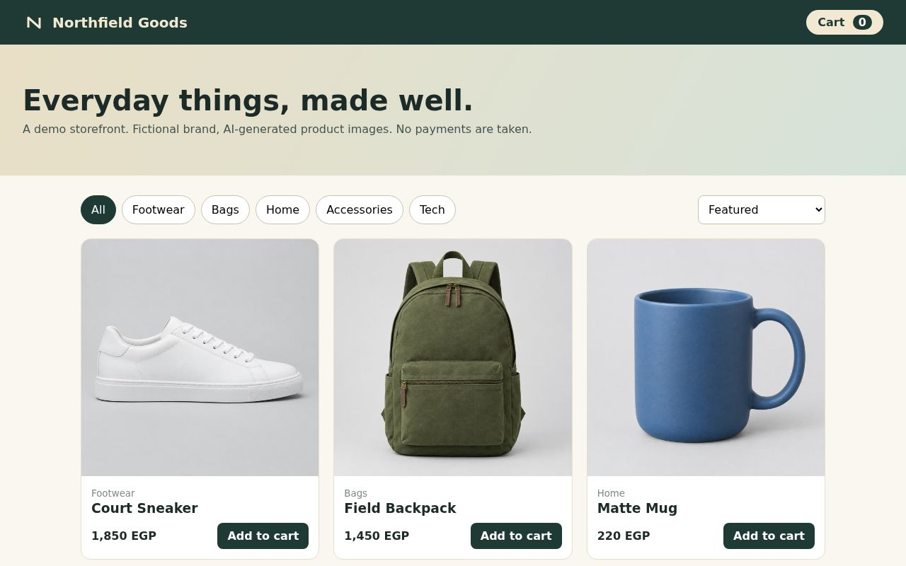
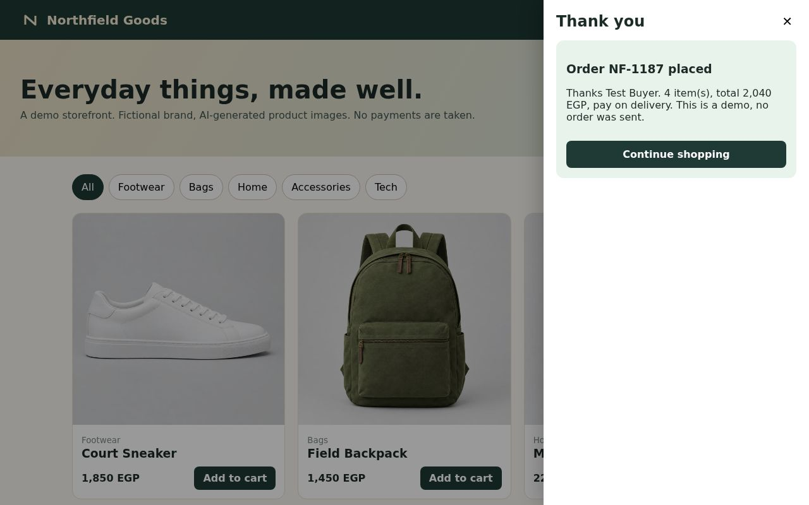
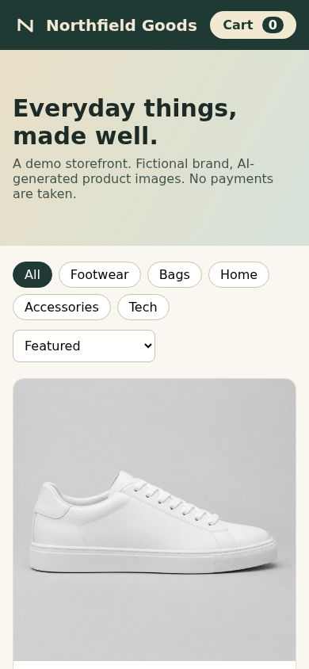

# Northfield Goods Storefront (React + Vite)

An e-commerce demo with cart and checkout form. The brand is fictional and the product photos are AI-generated. No payments are taken and no orders are sent anywhere.

## Features
- Product grid with category filter and price sorting
- Cart drawer: quantity controls (max 10 per item), cart kept in the browser
- Promo code `WELCOME10` (10% off), shipping 60 EGP, free from 1,500 EGP after discount
- Checkout form with validation, pay-on-delivery confirmation (demo)
- Responsive for desktop and mobile

## Run
```bash
npm install
npm run dev
npm run build
```

## Demo video
[docs/demo.mp4](docs/demo.mp4)

## Preview




## Tests
Headless Chrome checks (24): product count and images, filter and sort, cart maths with exact expected totals, invalid and valid promo, promo that pushes a cart below the free-shipping threshold, quantity changes and removal, persistence after reload, checkout validation, confirmation, mobile overflow, console errors.
